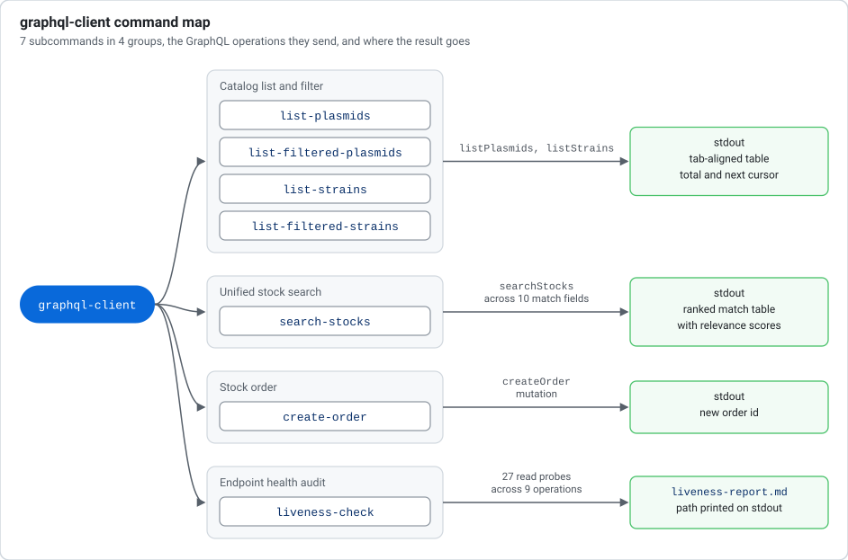
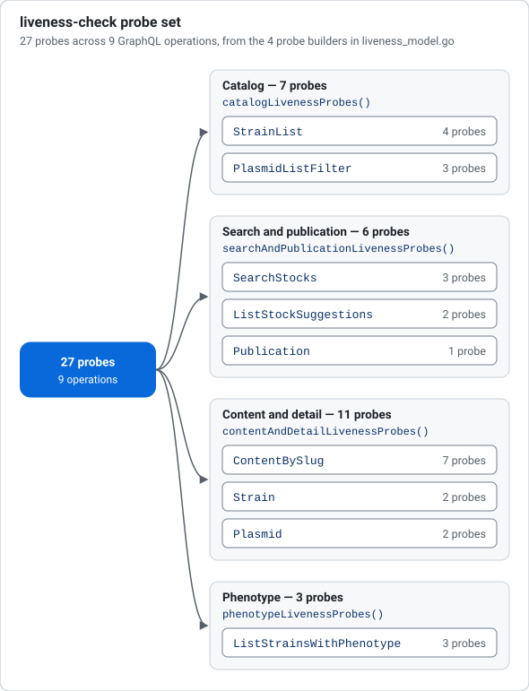
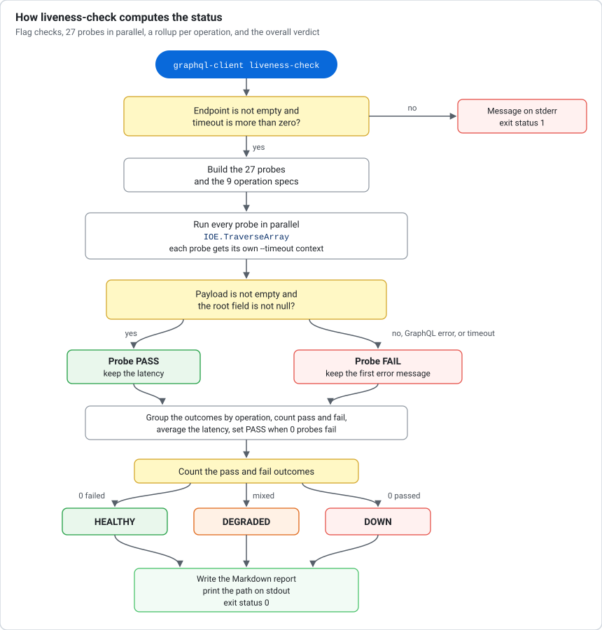
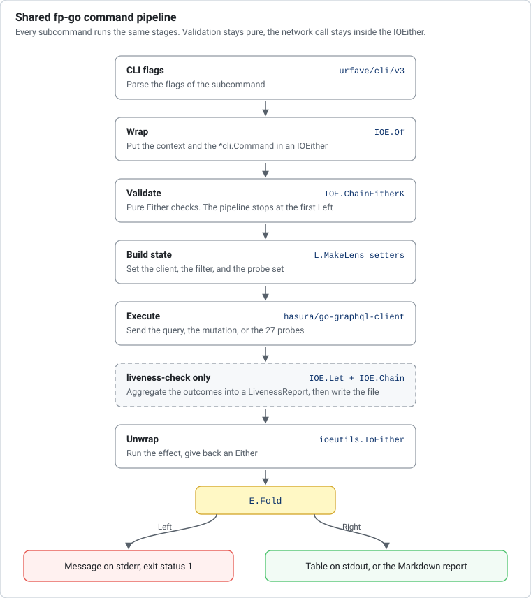

# graphql-client

`graphql-client` is a command line client for the dictyBase GraphQL API. It
lists and searches plasmid and strain stocks, it creates stock orders, and it
audits the health of the endpoint.

## Table of Contents

- [Installation](#installation)
  - [Clone and build](#clone-and-build)
  - [Install with `go install`](#install-with-go-install)
- [Quick Start](#quick-start)
- [Commands](#commands)
  - [list-plasmids](#list-plasmids)
  - [list-filtered-plasmids](#list-filtered-plasmids)
  - [list-strains](#list-strains)
  - [list-filtered-strains](#list-filtered-strains)
  - [search-stocks](#search-stocks)
  - [create-order](#create-order)
  - [liveness-check](#liveness-check)
- [Output](#output)
- [Development](#development)
  - [Prerequisites](#prerequisites)
  - [Test](#test)
  - [Lint](#lint)
  - [Format](#format)
- [Architecture](#architecture)
  - [Key Files](#key-files)

## Installation

### Clone and build

This command requires [Go 1.26 or later](https://go.dev/dl/). The file
`go.mod` sets the Go directive to `1.26.0`.

```bash
git clone https://github.com/dictyBase/graphql-client.git
cd graphql-client
go build -o graphql-client .
```

### Install with `go install`

```bash
go install github.com/dictyBase/graphql-client@latest
```

The command puts the `graphql-client` binary in `$GOPATH/bin`.

## Quick Start

```bash
# List the first 10 plasmids
./graphql-client list-plasmids

# List the first 10 strains
./graphql-client list-strains

# Filter plasmids by name
./graphql-client list-filtered-plasmids --name pDM

# Filter strains by label
./graphql-client list-filtered-strains --label DBS0352420

# Search stocks by a text query
./graphql-client search-stocks --query pDM

# Create a stock order
./graphql-client create-order --consumer jane@example.org --payer jane@example.org --items DBS0352420

# Audit the endpoint and write liveness-report.md
./graphql-client liveness-check
```

## Commands

`graphql-client` has 7 subcommands in 4 groups. Each group sends a different
set of GraphQL operations and writes a different kind of output. Every
subcommand accepts the `--endpoint` flag, which defaults to
`https://graphql.dictybase.dev/graphql`.



The 4 catalog commands read a page of the catalog. The search command finds a
stock when you know only a fragment of its text. The order command writes to
the API. The liveness command tests the API and writes a Markdown report.

### `list-plasmids`

List plasmids from the GraphQL endpoint. The `--type` flag filters the list by
plasmid type.

| Flag | Type | Default | Description |
|------|------|---------|-------------|
| `--endpoint` | string | `https://graphql.dictybase.dev/graphql` | GraphQL API endpoint URL |
| `--limit` | int | `10` | Number of entries to fetch |
| `--type` | string | `ALL` | Plasmid type: `ALL`, `REGULAR`, `GOLDEN_BRAID` |

```bash
./graphql-client list-plasmids --type REGULAR --limit 25
```

An unknown type fails before the network call with
`invalid plasmid type: <value>, must be one of: ALL, REGULAR, GOLDEN_BRAID`.

### `list-filtered-plasmids`

List plasmids from the GraphQL endpoint. This command adds a filter on the
plasmid name and on the plasmid summary to the type filter.

| Flag | Type | Default | Description |
|------|------|---------|-------------|
| `--endpoint` | string | `https://graphql.dictybase.dev/graphql` | GraphQL API endpoint URL |
| `--limit` | int | `10` | Number of entries to fetch |
| `--type` | string | `ALL` | Plasmid type: `ALL`, `REGULAR`, `GOLDEN_BRAID` |
| `--name` | string | — | Filter by plasmid name, substring match |
| `--summary` | string | — | Filter by plasmid summary, substring match |

```bash
./graphql-client list-filtered-plasmids --type GOLDEN_BRAID --name pDM
./graphql-client list-filtered-plasmids --type REGULAR --summary "expression vector" --limit 20
```

The command sends only the non-empty flag values in the GraphQL filter. It
omits an empty string flag from the filter.

### `list-strains`

List strains from the GraphQL endpoint. The `--type` flag filters the list by
strain type.

| Flag | Type | Default | Description |
|------|------|---------|-------------|
| `--endpoint` | string | `https://graphql.dictybase.dev/graphql` | GraphQL API endpoint URL |
| `--limit` | int | `10` | Number of entries to fetch |
| `--type` | string | `ALL` | Strain type: `ALL`, `REGULAR`, `GWDI`, `BACTERIAL` |

```bash
./graphql-client list-strains --type GWDI --limit 15
```

An unknown type fails before the network call with
`invalid strain type: <value>, must be one of: ALL, REGULAR, GWDI, BACTERIAL`.

### `list-filtered-strains`

List strains from the GraphQL endpoint. This command adds a filter on the
strain label and on the strain summary to the type filter.

| Flag | Type | Default | Description |
|------|------|---------|-------------|
| `--endpoint` | string | `https://graphql.dictybase.dev/graphql` | GraphQL API endpoint URL |
| `--limit` | int | `10` | Number of entries to fetch |
| `--type` | string | `ALL` | Strain type: `ALL`, `REGULAR`, `GWDI`, `BACTERIAL` |
| `--label` | string | — | Filter by strain label, substring match |
| `--summary` | string | — | Filter by strain summary, substring match |

```bash
./graphql-client list-filtered-strains --type BACTERIAL --label DBS
./graphql-client list-filtered-strains --type REGULAR --summary "axenic" --limit 20
```

### `search-stocks`

Search strains and plasmids with one text query. The server searches many stock
fields at the same time and sorts the results by relevance score. Use this
command when you know only a fragment of a name, a label, a gene, or a summary.
The command then gives you the stock accession.

| Flag | Type | Default | Description |
|------|------|---------|-------------|
| `--endpoint` | string | `https://graphql.dictybase.dev/graphql` | GraphQL API endpoint URL |
| `--query` | string | — | Search query, at least 2 characters (required) |
| `--limit` | int | `10` | Number of search results to fetch. The server accepts `0` to `100` |
| `--entity` | string | `ALL` | Stock entity to search: `ALL`, `STRAIN`, `PLASMID` |

```bash
./graphql-client search-stocks --query pDM
./graphql-client search-stocks --query axenic --entity STRAIN --limit 20
./graphql-client search-stocks --query GFP --entity PLASMID --limit 4
```

#### How the query matches

The query is one string. The command does not accept per-field flags. The
server applies the string to every searchable field and returns the best field
per stock.

- The query must have 2 characters or more. A shorter query fails before any
  network call with `invalid stock search query: must be at least 2 characters`.
- The match ignores letter case. `pDM`, `PDM`, and `pdm` return the same stocks.
- A prefix match ranks first. `pDM` matches the plasmid name `pDM309` and also
  the name `pdmpA::bsr`.
- A fuzzy match ranks after every prefix match. The query `309` matches the
  strain label `V30309` and the plasmid name `pDM309` with a much lower score.
- The `FIELD` column reports the field that matched the query. Therefore one
  query can return a `NAME` hit, a `LABEL` hit, and a `SUMMARY` hit together.

The server schema defines 10 match fields. The table lists each value of the
`StockSearchFieldEnum` type.

| `FIELD` value | Meaning | Seen in live probes |
|---------------|---------|---------------------|
| `STOCK_ID` | Stock accession, such as `DBS0236853` | yes |
| `LABEL` | Strain label, such as `rasC-/AX2` | yes |
| `NAME` | Plasmid name, such as `pDM309` | yes |
| `SUMMARY` | Free-text stock summary | yes |
| `SPECIES` | Strain species, such as `Polysphondylium pallidum` | yes |
| `GENES` | Associated gene name, such as `mhcA` | yes |
| `NAMES` | Alternate strain names | not seen |
| `PLASMID` | Plasmid reference of a strain | not seen |
| `DBXREFS` | External database cross-references | not seen |
| `DEPOSITOR` | Depositor of the stock | not seen |

#### Entity filter

The `--entity` flag limits the search to one stock type. The command validates
the value before it sends the request. An unknown value fails with
`invalid stock entity type: SPECIES, must be one of: ALL, STRAIN, PLASMID`.

| `--entity` | Result set | Use it when |
|------------|------------|-------------|
| `ALL` | Strains and plasmids in one ranked list | You do not know the stock type |
| `STRAIN` | Strains only, with the `LABEL` column filled | You want cell lines |
| `PLASMID` | Plasmids only, with an empty `LABEL` column | You want vectors |

```bash
# Both stock types, strongest matches first
./graphql-client search-stocks --query AX4 --limit 8

# Strains only
./graphql-client search-stocks --query rasC --entity STRAIN --limit 5

# Plasmids only
./graphql-client search-stocks --query pDM --entity PLASMID --limit 5
```

#### Read the output

The command prints one row per match and a total line. The columns come from
the `StockSearchResult` type of the API.

| Column | Content |
|--------|---------|
| `ID` | Stock accession. `DBS` marks a strain and `DBP` marks a plasmid. Pass this value to `create-order --items` |
| `ENTITY` | `STRAIN` or `PLASMID` |
| `FIELD` | The field that matched the query |
| `DISPLAY TEXT` | The text of the matched field |
| `IN STOCK` | `true` when the stock center holds inventory for the stock |
| `SCORE` | Relevance score with 4 decimals. A higher score ranks higher |
| `LABEL` | Strain label. The column stays empty for plasmids |
| `SUMMARY` | Stock summary. The text can repeat `DISPLAY TEXT` for a `SUMMARY` match |

The score is relative, not a percentage. A prefix match returns the top score
`1000.0000`. A fuzzy match returns a lower value, and the exact number depends
on the field and the corpus. Compare scores inside one result set only.

The `Total:` line reports the number of rows in the response, not the number of
stocks in the database. The search API has no cursor. To see more matches,
raise `--limit` up to `100`.

Strain search, with a label prefix match for every row:

```bash
./graphql-client search-stocks --query rasC --entity STRAIN --limit 5
```

```
ID           ENTITY   FIELD   DISPLAY TEXT   IN STOCK   SCORE       LABEL         SUMMARY
--           ------   -----   ------------   --------   -----       -----         -------
DBS0236853   STRAIN   LABEL   rasC-/AX2      true       1000.0000   rasC-/AX2     rasC null in AX2
DBS0236854   STRAIN   LABEL   rasC-/JH10     true       1000.0000   rasC-/JH10    rasC null in JH10
DBS0236855   STRAIN   LABEL   rasC-/dmpA-    true       1000.0000   rasC-/dmpA-   rasC-/dmpA- double null mutant...
DBS0236856   STRAIN   LABEL   rasC-/pikD1    true       1000.0000   rasC-/pikD1   REMI of rasC-, disrupting the pikD gene...
DBS0236857   STRAIN   LABEL   rasC-/rasD-    false      1000.0000   rasC-/rasD-   rasC/rasD double null mutant

Total: 5
```

Mixed search, with prefix matches first and summary matches after them:

```bash
./graphql-client search-stocks --query AX4 --limit 6
```

```
ID           ENTITY   FIELD     DISPLAY TEXT       IN STOCK   SCORE       LABEL             SUMMARY
--           ------   -----     ------------       --------   -----       -----             -------
DBS0237637   STRAIN   LABEL     AX4                true       1000.0000   AX4               Adam Kuspa lab strain; axenic...
DBS0307938   STRAIN   LABEL     AX4/[tagB]:lacZ    true       1000.0000   AX4/[tagB]:lacZ   lacZ taggedneomycin resistant
DBS0349730   STRAIN   LABEL     AX4/ura-           true       1000.0000   AX4/ura-          pyr56-null strain with Uracil auxotrophy...
DBS0351471   STRAIN   LABEL     AX4                true       1000.0000   AX4               AX4 strain from the Thompson lab...
DBS0236498   STRAIN   SUMMARY   lagD- in AX4       false      507.7521    lagD-             lagD- in AX4
DBS0235916   STRAIN   SUMMARY   dnmA null in AX4   false      507.5391    dnmA-             dnmA null in AX4

Total: 6
```

A query with no match prints the header and a message:

```
ID   ENTITY   FIELD   DISPLAY TEXT   IN STOCK   SCORE   LABEL   SUMMARY
--   ------   -----   ------------   --------   -----   -----   -------

No stocks found.
```

#### Errors

| Condition | Message | Found by |
|-----------|---------|----------|
| Query shorter than 2 characters | `invalid stock search query: must be at least 2 characters` | CLI, before the request |
| Entity outside the enum | `invalid stock entity type: <value>, must be one of: ALL, STRAIN, PLASMID` | CLI, before the request |
| `--limit` above `100` or below `0` | `graphql query failed: ... validation error: - data.attributes.limit: value must be greater than or equal to 0 and less than or equal to 100` | Server |

The command exits with status 1 on an error and writes the message to standard
error. A `--limit` of `0` is valid and the server then applies its own default
of 50 results.

### `create-order`

Send a stock order to the GraphQL endpoint. Only `--consumer`, `--payer`, and
`--items` need real values. The other flags have defaults that you can keep.

| Flag | Type | Default | Description |
|------|------|---------|-------------|
| `--endpoint` | string | `https://graphql.dictybase.dev/graphql` | GraphQL API endpoint URL |
| `--consumer` | string | — | Consumer email address, receives the invoice (required) |
| `--payer` | string | — | Payer email address, shown in the invoice (required) |
| `--items` | string | — | Stock item ids (DBS/DBP accessions). Repeat the flag or use commas (required) |
| `--purchaser` | string | `fake-purchaser@example.org` | Purchaser email address |
| `--courier` | string | `FedEx` | Courier name |
| `--courier-account` | string | `FAKE-ACCT-0001` | Courier account number |
| `--payment` | string | `credit_card` | Payment method |
| `--comments` | string | `automated CLI test order` | Order comments |
| `--purchase-order-num` | string | `PO-FAKE-0001` | Purchase order number |
| `--status` | string | `IN_PREPARATION` | Order status: `IN_PREPARATION`, `GROWING`, `CANCELLED`, `SHIPPED` |

```bash
./graphql-client create-order \
  --consumer jane@example.org \
  --payer jane@example.org \
  --items DBS0352420 --items DBP1234
```

The command runs 3 checks before it sends the `createOrder` mutation.

| Check | Rule | Message |
|-------|------|---------|
| Email addresses | `--consumer`, `--payer`, and `--purchaser` must contain an at sign | `invalid <field> email: must be a valid address` |
| Order status | `--status` must be a value of the `StatusEnum` type | `invalid order status: <value>, must be one of: IN_PREPARATION, GROWING, CANCELLED, SHIPPED` |
| Order items | `--items` must hold at least one accession | `at least one stock item id is required` |

The email check tests only for an at sign. The server does the full address
check. On success, the command prints the new order ID.

### `liveness-check`

Audit the dictyBase GraphQL API and write a Markdown report. The command sends
27 read probes across 9 GraphQL operations. Each probe uses a real input value
from a production route of the dictyBase website. Use this command to find out
which part of the API is down before you debug the website.

| Flag | Type | Default | Description |
|------|------|---------|-------------|
| `--endpoint` | string | `https://graphql.dictybase.dev/graphql` | GraphQL API endpoint URL |
| `--timeout` | duration | `30s` | Per-request timeout for each GraphQL liveness probe |
| `--output` | string | `liveness-report.md` | Path of the Markdown report file to write |

```bash
# Audit the default endpoint and write liveness-report.md
./graphql-client liveness-check

# Audit a local API with a shorter timeout and a custom report path
./graphql-client liveness-check \
  --endpoint http://localhost:8080/graphql \
  --timeout 10s \
  --output /tmp/dev-liveness.md
```

An empty `--endpoint` fails with `endpoint URL is required`. A `--timeout` of
zero or less fails with `timeout must be greater than zero`. Both checks run
before the first request.

#### The 27 probes

The command builds the probe set from 4 groups. The groups follow the 4 probe
builder functions in `liveness_model.go`.



| Operation | Route area | Root field | Probes | Probe inputs |
|-----------|------------|------------|--------|--------------|
| `StrainList` | `/strains, /catalog` | `listStrains` | 4 | `strain_type` of `ALL`, `REGULAR`, `GWDI`, `BACTERIAL`, with `limit` 12 |
| `PlasmidListFilter` | `/plasmids, /catalog` | `listPlasmids` | 3 | `plasmid_type` of `ALL`, `REGULAR`, `GOLDEN_BRAID`, with `limit` 12 |
| `SearchStocks` | `/catalog?q=...` | `searchStocks` | 3 | `query="act"` with no entity, with `STRAIN`, and with `PLASMID`, at `limit` 50 |
| `ListStockSuggestions` | Navbar search | `listStockSuggestions` | 2 | `query="act"` and `query="gfp"`, with `limit` 12 |
| `Publication` | Reference preview | `publication` | 1 | `id="12857872"` |
| `ContentBySlug` | Info & community pages | `contentBySlug` | 7 | `stockcenter-order`, `stockcenter-deposit`, `stockcenter-payment`, `stockcenter-faq`, `frontpage-gallery`, `frontpage-show`, `frontpage-DSC_SOP_OIM_Aug22.pdf` |
| `Strain` | `/strains/:id` | `strain` | 2 | `id="DBS0350026"` and `id="DBS0305923"` |
| `Plasmid` | `/plasmids/:id` | `plasmid` | 2 | `id="DBP0391806"` and `id="DBP0001102"` |
| `ListStrainsWithPhenotype` | `/phenotypes/:name` | `listStrainsWithAnnotation` | 3 | `annotation` of `wild type`, `aberrant aggregation`, `decreased growth rate`, with `limit` 50 |

#### How the command computes the status



A probe passes only when the response payload is not empty and the root field
of the response holds data that is not `null`. A GraphQL error, a transport
error, or a timeout makes the probe fail. The report keeps the first error
message of the response.

| Overall status | Rule |
|----------------|------|
| `HEALTHY` | 0 probes fail |
| `DEGRADED` | Some probes pass and some probes fail |
| `DOWN` | 0 probes pass |

The `Latency` column of the report gives the mean latency of the probes of one
operation. The `Duration` cell of the summary table gives the wall clock time
of the full run. The run time is much shorter than the sum of the latencies,
because the probes run in parallel.

> **Note**
> A failed probe does not change the exit status. The command exits with
> status 0 and writes the report, even for a `DOWN` endpoint. Read the
> `Status` cell of the report, or grep the report for `**DOWN**`, in a CI job.
> Only a bad flag value or a report write error gives exit status 1.

#### Report output

```bash
./graphql-client liveness-check
```

```
Liveness report written to liveness-report.md
```

The command overwrites the report file on each run. The file mode is `0644`.
This report comes from a real run against the default endpoint:

```markdown
# GraphQL API Liveness Report

| Endpoint | Status | Probes | Passed | Failed | Duration |
|:--------|:--------|--------:|--------:|--------:|--------:|
| `https://graphql.dictybase.dev/graphql` | **DEGRADED** | 27 | 25 | 2 | 19.292s |

## Operation Health

| Operation | Route Area | Passed | Failed | Latency | Status |
|:--------|:--------|--------:|--------:|--------:|:--------|
| `StrainList` | /strains, /catalog | 4/4 | 0 | 1.608s | **PASS** |
| `PlasmidListFilter` | /plasmids, /catalog | 3/3 | 0 | 867ms | **PASS** |
| `SearchStocks` | /catalog?q=... | 3/3 | 0 | 9.088s | **PASS** |
| `ListStockSuggestions` | Navbar search | 2/2 | 0 | 4.629s | **PASS** |
| `Publication` | Reference preview | 1/1 | 0 | 304ms | **PASS** |
| `ContentBySlug` | Info & community pages | 5/7 | 2 | 1.355s | **FAIL** |
| `Strain` | /strains/:id | 2/2 | 0 | 1.061s | **PASS** |
| `Plasmid` | /plasmids/:id | 2/2 | 0 | 1.026s | **PASS** |
| `ListStrainsWithPhenotype` | /phenotypes/:name | 3/3 | 0 | 16.93s | **PASS** |

## Failure Summary

- **`ContentBySlug`** (`slug="frontpage-show"`): `slug frontpage-show not found`
- **`ContentBySlug`** (`slug="frontpage-DSC_SOP_OIM_Aug22.pdf"`): `slug frontpage-DSC_SOP_OIM_Aug22.pdf not found`
```

A run with no failure writes the bullet `All GraphQL liveness probes passed.`
in the `Failure Summary` section.

## Output

The 6 query and mutation commands write a tab-aligned table and a summary line
to standard output. The `liveness-check` command writes a Markdown file and
prints the path of the file.

**Plasmids:**

```
ID      NAME        IN STOCK  SUMMARY
--      ----        --------  -------
DBP123  pDM304      true      expression vector for D. discoideum

Total: 142 | Next cursor: 10
```

**Strains:**

```
ID        LABEL         IN STOCK  SUMMARY
--        -----         --------  -------
DBS03524  DBS0352420    true      axenic strain

Total: 87 | Next cursor: 10
```

**Stock search:**

```
ID           ENTITY    FIELD   DISPLAY TEXT   IN STOCK   SCORE       LABEL   SUMMARY
--           ------    -----   ------------   --------   -----       -----   -------
DBP0000511   PLASMID   NAME    pdmpA::bsr     true       1000.0000           Remi rescued plasmid...

Total: 5
```

**Orders:**

```
Order created: 17342e12-acd0-4f2a-9456-123e51c0
```

**Liveness check:**

```
Liveness report written to liveness-report.md
```

## Development

### Prerequisites

- Go 1.26+

### Test

```bash
gotestsum --format pkgname-and-test-fails --format-hide-empty-pkg -- ./...
```

### Lint

```bash
golangci-lint run ./...
```

### Format

```bash
golangci-lint fmt
```

## Architecture

Every command uses the same functional pipeline. The pipeline comes from
[fp-go](https://github.com/IBM/fp-go) and
[fp-go-loom](https://github.com/dictyBase/fp-go-loom). An `IOEither` carries
the effect, an `Either` carries the pure validation, and a lens sets each field
of the command state.



| Stage | Code | Purpose |
|-------|------|---------|
| Wrap | `IOE.Of` | Put the context and the `*cli.Command` in an `IOEither` |
| Validate | `IOE.ChainEitherK` | Run pure `Either` checks. The pipeline stops at the first `Left` |
| Build state | `L.MakeLens` setters | Build the GraphQL client, the filter, and the request state |
| Execute | `IOE.Chain` | Send the query, the mutation, or the 27 liveness probes |
| Unwrap | `ioeutils.ToEither` | Run the effect and give an `Either` |
| Fold | `E.Fold` | Print the error, or render the table or the report |

The validation stays pure, and the network call stays inside the `IOEither`.
Therefore a bad flag value costs no request. The `liveness-check` pipeline adds
2 stages between Execute and Unwrap: it aggregates the probe outcomes into a
`LivenessReport`, and then it writes the Markdown file.

### Key Files

| File | Purpose |
|------|---------|
| `main.go` | Entry point, flag names, and default values |
| `cli_registry.go` | Command and flag descriptors of the 7 subcommands |
| `cmd.go` | Pipelines of the list, search, and order commands |
| `model.go` | GraphQL query structs, filter types, and result types |
| `display.go` | Tab-aligned table output and Markdown report output |
| `errors.go` | Typed error constructors |
| `liveness.go` | Pipeline of `liveness-check`: validation, probe run, report write |
| `liveness_model.go` | Probe definitions, GraphQL documents, and report types |
| `liveness_lenses.go` | Every lens of the project, not only the liveness lenses |
